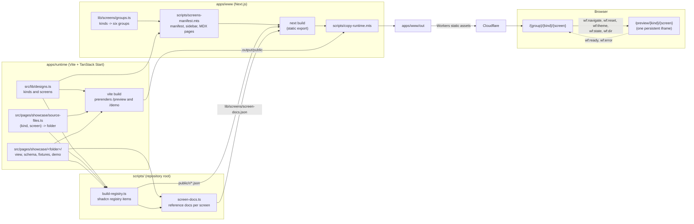

# Wirefront

**Production-grade UI screens, ready to wire to any backend.**

A backend-agnostic catalogue of production-grade UI screens built on [shadcn/ui](https://ui.shadcn.com) with [Base UI](https://base-ui.com) and Tailwind v4, organised by the experience they serve. Every screen is adaptive, dynamic and responsive: install it with the shadcn CLI, wire it to your backend and tweak it locally.

[wirefront.mantavyam.in](https://wirefront.mantavyam.in) · By [Mantavyam Studios](https://mantavyam.com) · [GitHub](https://github.com/mantavyamstudios) · [Book a call](https://cal.com/mantavyam/business)

## Contents

- [Tech stack](#tech-stack)
- [Architecture](#architecture)
- [Repository layout](#repository-layout)
- [Prerequisites](#prerequisites)
- [Installation](#installation)
- [Local development](#local-development)
- [What a screen is](#what-a-screen-is)
- [Adding, editing and removing screens](#adding-editing-and-removing-screens)
- [The site](#the-site)
- [Checks and tests](#checks-and-tests)
- [Continuous integration](#continuous-integration)
- [Production deployment](#production-deployment)
- [Configuration reference](#configuration-reference)
- [Useful commands](#useful-commands)
- [Contributing](#contributing)
- [Credits](#credits)
- [License](#license)

## Tech stack

| Layer | Technology |
| --- | --- |
| Screens | React 19, TypeScript, [shadcn/ui](https://ui.shadcn.com) (base-nova) on [Base UI](https://base-ui.com) 1.9, Tailwind CSS v4, zod 4, lucide-react, Motion |
| Preview runtime (`apps/runtime`) | Vite 8 + TanStack Start, prerendered to static pages (`/preview/<kind>/<screen>`, `/demo`) |
| Website (`apps/www`) | Next.js 16 (App Router, static export), React 19.3, the Sora UI shell from the Enterprise UI Playground |
| Docs and search | Fumadocs (MDX docs and screen pages, static search index), Shiki highlighting |
| Distribution | The shadcn registry: one item per screen at `/r/<kind>-<screen>.json` |
| Monorepo | Bun 1.4.5 workspaces, Turborepo |
| Tests | Vitest and Testing Library (unit and wiring tests), Playwright (browser, responsive, visual, site and bridge checks), axe-core |
| Lint and format | Biome (lint and format) for the runtime, UI package, bridge and scripts, behind a ratcheting lint gate (`lint-baseline.json`); Ultracite (oxlint and oxfmt, strict preset) for the site and the shell. Both formatters use the same style |
| Hosting | Cloudflare Workers static assets (`wrangler.jsonc`), no Worker script |
| CI | GitHub Actions (`.github/workflows/ci.yml`), CLA Assistant (`.github/workflows/cla.yml`) |

## Architecture

Everything that ships is static files. The shadcn registry, the preview runtime's pages and the website are generated at build time from one source of truth: the catalogue in `apps/runtime`. Every screen page on the site loads the runtime once in an iframe and switches screens, theme, state, palette and direction by message, without reloading.



**Build order.** `bun run build` runs `bun run registry` first (the root `prebuild`), then Turborepo builds `@wirefront/runtime` before `@wirefront/www`. The site's own `prebuild` syncs the screens manifest, writes the screen docs and the docs registry, and fetches the studio avatar; its `postbuild` copies the runtime's prerendered pages into `apps/www/out`, failing if a file would overwrite one of the site's.

**The bridge.** `packages/bridge` (`@wirefront/bridge`) defines and validates the messages both sides exchange:

| Message | Direction | Meaning |
| --- | --- | --- |
| `wf:navigate { category, design }` | site to runtime | show another screen in the same document |
| `wf:reset` | site to runtime | replay the screen from its first render |
| `wf:theme { mode, palette? }` | site to runtime | light or dark, and the accent palette |
| `wf:state { state }` | site to runtime | `ready`, `loading`, `empty`, `error` or `forbidden` |
| `wf:dir { dir }` | site to runtime | `ltr` or `rtl` |
| `wf:ready { category, design }` | runtime to site | the requested screen has mounted |
| `wf:error { message }` | runtime to site | the screen could not be shown |

The runtime accepts messages only from its own origin and, in development, from `VITE_SHELL_ORIGIN`; the site accepts messages only from the iframe's window at `NEXT_PUBLIC_RUNTIME_ORIGIN` (its own origin in production).

## Repository layout

```text
apps/
├── runtime/                       the screens and their preview runtime (port 4000)
│   ├── src/lib/designs.ts         the catalogue: kinds (categories) and their screens
│   ├── src/pages/showcase/        one folder per ready-to-wire screen (view, schema, fixtures, demo)
│   │   ├── source-files.ts        (kind, screen) -> folder; the registry and the runtime read it
│   │   └── registry.tsx           derives the preview components from source-files.ts
│   ├── src/routes/                /preview/$category/$design and /demo
│   └── tests/                     unit, contract, catalogue and wiring tests (Vitest)
└── www/                           the website (port 3000)
    ├── app/                       routes: landing, galleries, screen pages, docs, pricing, legal, llms, OG
    ├── components/screens/        the persistent preview frame, toolbar controls, screen reference
    ├── content/docs/              documentation pages (MDX)
    ├── content/screens/           one MDX page per screen, created once and then yours to edit
    ├── lib/screens/               groups.ts, the generated manifest and data helpers
    ├── public/r/                  the shadcn registry (generated, not committed)
    ├── public/previews/           gallery previews, light and dark (committed)
    └── scripts/                   manifest sync, docs registry, dev watcher, runtime copy, avatar
packages/
├── ui/                            shadcn/ui components and Wirefront's contract helpers (packages/ui/src/wirefront)
├── bridge/                        the site <-> runtime messages
├── shell-ui/                      the site's own components (@workspace/ui)
└── typescript-config/             shared tsconfig presets
scripts/                           registry build, screen docs, scaffold, every check and audit
.githooks/                         pre-commit (catalogue sync) and pre-push (typecheck, licence, lint, tests)
```

## Prerequisites

| Tool | Version | Used for |
| --- | --- | --- |
| [Bun](https://bun.sh) | 1.4.5 (`packageManager` in `package.json`) | installing packages and running every script |
| [Node.js](https://nodejs.org) | 26 LTS (`.node-version`: 26.13.1) | Next.js, Vite, `tsx` scripts and `wrangler`; CI and Cloudflare read the same file |
| Tailwind CSS | 4.3.5 in this repository; 4.3 or later in a builder's app (the screens use 4.3 utilities such as `scrollbar-none` and `inset-s-*`) | styling |
| Git | any | hooks; "last updated" dates on docs pages |
| Playwright Chromium | installed by `npx playwright install chromium` | browser checks, previews, the site and bridge tests |

macOS, Linux and Windows (WSL) all work. A Cloudflare account is only needed to deploy.

## Installation

Run every command from the repository root unless a block starts with `cd`.

1. **Clone.**

   ```bash
   git clone https://github.com/mantavyamstudios/wirefront.git
   cd wirefront
   ```

2. **Install packages.** This also points git at `.githooks/` (the root `prepare` script).

   ```bash
   bun install
   ```

3. **Install the browser** used by the checks and the preview capture:

   ```bash
   npx playwright install chromium
   ```

4. **Environment.** Nothing is required. `apps/www/.env.development` and `apps/runtime/.env.development` (committed) wire the two dev servers to each other; `apps/www/.env.example` lists the optional variables.

## Local development

```bash
bun run dev               # site on http://localhost:3000, runtime on http://localhost:4000
```

`dev` builds the registry, syncs the screens manifest, writes the screen docs, then starts both apps. While it runs, the site's dev watcher (`apps/www/scripts/dev.mts`) re-syncs the site whenever a screen folder, `designs.ts`, `source-files.ts` or `groups.ts` changes, so new and changed screens appear without a restart. In development the site embeds the runtime from port 4000 (`NEXT_PUBLIC_RUNTIME_ORIGIN`), and the runtime accepts its messages from port 3000 (`VITE_SHELL_ORIGIN`).

`bun run dev:runtime` starts the runtime alone: `http://localhost:4000/preview/<kind>/<screen>` shows one screen full page, and `?state=loading` or `?dir=rtl` previews a state or direction.

**Production preview:** the exact files that get deployed, served by `wrangler` as Cloudflare serves them:

```bash
bun run build
bunx wrangler dev         # serves apps/www/out
```

## What a screen is

A ready-to-wire screen is a folder `apps/runtime/src/pages/showcase/<kind>-<screen>/` that follows [SCREEN-CONTRACT.md](SCREEN-CONTRACT.md):

| File | What it holds | Shipped by the registry? |
| --- | --- | --- |
| `view.tsx` | the screen: props in, UI out; no data, fetching or router; every string in a `<NAME>_MESSAGES` object | yes |
| `schema.ts` | zod schemas, their inferred types and `export const api = defineApi({…})`, the backend operations | yes |
| `fixtures.ts` | demo data that satisfies the schemas, named after the operations | yes |
| `demo.tsx` | the showcase wiring: fixtures, simulated actions and the previewed state (`<Name>ShowcasePage`) | no |

The view builds on the contract helpers in `packages/ui/src/wirefront/` (`WirefrontProvider`, `useAction`, `useActionForm`, list queries, `ScreenBoundary`, `defineApi`), which install beside the screen under `components/wirefront/`. The contract checker (`scripts/lib/contract.ts`, run by `apps/runtime/tests/contract.test.ts`) enforces the layout and the rules on every push. [WIRING.md](WIRING.md) shows screens wired with plain `fetch`, TanStack Query and Next.js server actions.

## Adding, editing and removing screens

The catalogue is the single source of truth. Nothing on the site lists screens by hand: everything below is generated from `apps/runtime/src/lib/designs.ts`, `apps/runtime/src/pages/showcase/source-files.ts`, the screen folders and `apps/www/lib/screens/groups.ts`.

| Generated file | What it holds | Committed? | Overwritten on sync? |
| --- | --- | --- | --- |
| `apps/www/public/r/<kind>-<screen>.json`, `registry.json` | the shadcn registry items, with their files, packages, shadcn components and CSS variables | no | yes |
| `apps/www/lib/screens/screens.manifest.json` | groups, kinds and screens with their source files, states and registry names | yes | yes |
| `apps/www/content/screens/meta.json` | sidebar order, one separator per group | yes | yes |
| `apps/www/content/screens/<group>/<kind>/<screen>.mdx` | the screen page's title, description and editorial notes | yes | no: created once, then yours to edit |
| `apps/www/lib/screens/screen-docs.json` | each screen's reference (usage, props, backend contract, data types, copy, dependencies) | no | yes |
| `apps/www/__registry__/` | the docs toolkit's registry (`ComponentPreview`, `ComponentInstallation`) | no | yes |
| `apps/www/public/previews/<kind>__<screen>--{light,dark}.png` | gallery previews | yes | only when you run `bun run snapshot` |

### Automatic sync

- **`bun run dev` and `bun run build`** run the sync first; unchanged files are left alone.
- **While `bun run dev` runs**, the dev watcher re-syncs on every change to a screen or the catalogue.
- **On commit**, the pre-commit hook (`.githooks/pre-commit`) re-syncs when the commit touches a screen, the catalogue, the groups or a screen page, adds the regenerated manifest, `meta.json` and new MDX pages to the commit, and fails if anything still drifts.
- **In CI**, `screens:check` fails on drift and `screens:docs --check` typechecks every screen's usage example against the real screen.
- **Counts, navigation and pages** (the gallery, group and kind pages, the sidebar, the command palette, the site map, OG images and LLM text) are read from the manifest, so they follow without edits.

What still needs a person: the screen itself, its editorial MDX page, and reviewing its previews after visual changes.

### Add a screen

One command scaffolds it, registers it and regenerates everything:

```bash
bun run screen:new <group>/<kind>/<screen> --title="Release notes" --blurb="What shipped, newest first."
```

It writes `apps/runtime/src/pages/showcase/<kind>-<screen>/` (a contract-compliant list screen with loading, empty and error states and a create action), wiring tests in `apps/runtime/tests/<kind>-<screen>.test.tsx`, and adds entries to `designs.ts`, `source-files.ts` and, for a new kind, `groups.ts`. Existing entries are never rewritten. Then it builds the registry, syncs the manifest (which creates the MDX page), writes and typechecks the screen docs, and captures the light and dark previews (`--skip-snapshot` to leave that for later). The scaffold passes every check as written.

- **A new kind** also takes `--kind-title="…" --kind-blurb="…"` and optionally `--icon=<Wireframe… icon imported in designs.ts>` (default `WireframeCard`); it is added to the `CategorySlug` union, `CATEGORIES`, `SOURCE_FILES` and the group's kinds.
- **A new group** also takes `--group-title="…" --group-meaning="…"`. Group slugs may not collide with the site's own top-level routes or public folders; the manifest sync fails if one does.

Then:

1. Replace the scaffold's view, schema, fixtures and demo with the real screen, keeping the contract, and its tests.
2. Write its page in `apps/www/content/screens/<group>/<kind>/<screen>.mdx`. The reference below it is generated.
3. Check it: `bun run test`, `bun run test:browser -- --design=<kind>/<screen>`, `bun run audit:responsive -- --design=<kind>/<screen> --strict`.
4. After visual changes, `bun run snapshot -- --design=<kind>/<screen>`.
5. Commit the screen, its test, the catalogue edits, the manifest, `meta.json`, the MDX page and the previews.

**By hand** (what `screen:new` does): create the folder, add `{ slug, title, blurb, status?, states? }` to its kind's `designs` in `designs.ts`, map `"<screen>": "<folder>"` under the kind in `source-files.ts`, then run `bun run dev` (or `bun run registry && bun run --cwd apps/www screens:manifest`) and `bun run snapshot -- --design=<kind>/<screen>`.

### Edit a screen

- **Screen code:** edit its folder. The registry, the Code tab and the reference docs are read from the files at build time, and the dev watcher refreshes them while `dev` runs.
- **Title, blurb, status or states:** edit its entry in `designs.ts`; the sync updates the manifest and sidebar. Update the MDX page's `title` and `description` too if they should match.
- **Editorial docs:** edit its MDX page.
- **Previews:** `bun run snapshot -- --design=<kind>/<screen>`; `bun run test:visual` compares against them.

### Rename a screen (change its slug)

Change `slug` in `designs.ts` and the key in `source-files.ts`, rename its MDX page and its two previews to the new slug, and run the sync. URLs have no redirects: the old address returns 404.

### Remove a screen

Delete its entry from `designs.ts` and `source-files.ts`, its folder, its tests, its MDX page and its previews. The sync reports leftover MDX pages as orphans instead of deleting them, and `screens:check` and the catalogue tests fail until they are gone.

### Move a kind to another group

Move its slug between groups in `apps/www/lib/screens/groups.ts`, move `apps/www/content/screens/<old-group>/<kind>/` to the new group, and run the sync. Every kind belongs to exactly one group; the sync fails otherwise.

## The site

### Addresses

| Address | What it is |
| --- | --- |
| `/` | landing page |
| `/screens` | every screen, by kind |
| `/{group}` | one group's kinds and screens, for example `/accounts` |
| `/{group}/{kind}` | one kind's screens, for example `/accounts/pricing` |
| `/{group}/{kind}/{screen}` | a screen page, for example `/data/tables/members` |
| `/docs`, `/docs/installation`, `/docs/wiring`, `/docs/contact`, `/docs/license` | documentation |
| `/pricing`, `/legal/privacy`, `/legal/terms` | the site's own pages |
| `/r/<kind>-<screen>.json`, `/r/registry.json` | the shadcn registry |
| `/preview/<kind>/<screen>`, `/demo` | the runtime's pages (the iframe, the demo app) |
| `/api/screens/source/<kind>/<screen>` | a screen's files, highlighted (the Code tab) |
| `/llms.txt`, `/llms-full.txt`, `/llms.mdx/<page>`, `/llms-screens.mdx/<group>/<kind>/<screen>` | Markdown for LLMs |

The six groups are Shells (layouts), Accounts (auth, settings, profile, pricing), Data (dashboards, tables, charts, filters), Activity (cards, timelines, calendars, threads), Interaction (forms, modals, toasts, tours, empty states) and Products (apps, AI, dev tools, personal, commerce). `/contact`, `/support`, `/privacy` and `/terms` redirect to their pages (`apps/www/public/_redirects`); screens have no redirects.

### Screen pages

A screen page is the persistent split view from the Sora UI shell: the screen on the right, its docs on the left. The preview shows the screen in a phone, tablet or laptop frame (rotate, replay, expand with `⌘J`, light or dark), and the toolbar under it switches the screen's declared states, the accent palette and the layout direction. The Code tab lists the files the screen installs.

The docs column starts with the page's table of contents and the editorial MDX page, then the reference generated by `scripts/screen-docs.ts` from the screen's code:

| Section | Where it comes from |
| --- | --- |
| Installation | the registry item (`ComponentInstallation`: CLI command, manual steps, file tree) |
| Usage | a usage example built from the demo and the fixtures; CI typechecks it against the screen |
| Props | the view's props: types as written, JSDoc descriptions, destructured defaults |
| Backend contract | `api` in `schema.ts`: operation, method and path, params, query, body, response, error codes |
| Data types | the types `schema.ts` exports, with the JSDoc on each field |
| States | `states` in `designs.ts` |
| Copy | the view's `<NAME>_MESSAGES` and its `useMessages` namespace, for `WirefrontProvider messages` |
| Permissions | the `can("action", "resource")` checks in the view |
| Dependencies | the registry item's npm packages, shadcn components and files |
| Quality | the checks every screen passes |

The same reference is appended to the screen's Markdown at `/llms-screens.mdx/…`.

## Checks and tests

[TESTING.md](TESTING.md) lists the failure modes each check covers. Nothing is skipped, silenced or retried into passing.

[CHECKS.md](CHECKS.md) is the reference for what runs where (linters, formatters, git hooks, CI), every rule switched off or suppressed and why, the baselines, known warnings, deprecations and planned cleanup.

| Command | What it checks |
| --- | --- |
| `bun run typecheck` | every workspace, including the strict template settings (`tsconfig.shipped.json`) and `scripts/` |
| `bun run test` | unit, wiring, contract and catalogue tests (Vitest) |
| `bun run lint` | Biome on the runtime, the UI package, the bridge and `scripts/`; errors fail, warnings are printed |
| `bun run format:check` | Biome's formatter on the same folders; unformatted files fail (`bun run format` fixes them) |
| `bun run --cwd apps/www lint`, `bun run --cwd packages/shell-ui lint` | Ultracite on the site and the shell: oxlint (errors fail, warnings are printed) and an oxfmt format check |
| `bun run lint:gate` | no new lint errors against `lint-baseline.json` (empty: there is no lint debt); warnings are listed, and annotated in CI, but never fail |
| `bun run spdx:check` | the MIT licence header on every source file |
| `bun run --cwd apps/www screens:check` | the manifest, sidebar and MDX pages match the catalogue |
| `bun run --cwd apps/www screens:docs --check` | every screen's usage example typechecks against the screen |
| `bun run test:bridge` | the site <-> runtime messages, in a browser |
| `bun run test:site` | the built site served by wrangler: addresses, galleries, the persistent iframe, theme, toolbar controls, the screen reference, the docs toolkit, console errors |
| `bun run test:browser` | every screen in every declared state at 375 and 1440 px: runtime errors, hydration, axe accessibility |
| `bun run audit:responsive -- --strict` | every screen at 375, 768, 1024 and 1440 px (`--rtl` for RTL) |
| `bun run test:visual` | the screens against their committed previews |
| `bun run test:install` | every registry item installed into fresh Next.js, Vite and TanStack Start apps, which then typecheck and build |
| `bun run test:bundle` | each screen's gzipped size against `bundle-budget.json` |

The pre-push hook runs the typecheck, the licence check, the lint gate, the format check and the tests.

## Continuous integration

`.github/workflows/ci.yml` runs on every push to `main` and every pull request:

| Job | Steps |
| --- | --- |
| Typecheck, licence headers, tests, build, bundle budget | `typecheck`, `spdx:check`, `test`, `build`, `test:bundle` |
| Lint | `lint:gate`, `lint`, `format:check`, then Ultracite on the site and the shell; lint errors or unformatted files fail the run, warnings are reported only |
| Install | `test:install` |
| Browser check | `test:browser`, report uploaded |
| Responsive audit | `audit:responsive -- --strict`, report uploaded |
| Site | `screens:check`, `test:bridge`, `build`, `screens:docs --check`, `test:site` |
| Deploy to Cloudflare Workers | runs only when every job above passed: production on a push to `main`, a Preview on a pull request from this repository (see [Production deployment](#production-deployment)) |

Every job reads Node from `.node-version`. Runs on `main` are never cancelled by a newer push, so a deploy never stops halfway; a newer push to a pull request cancels its older run. `.github/workflows/preview-cleanup.yml` deletes a pull request's Preview when it closes.

`.github/workflows/cla.yml` asks first-time contributors to sign the [CLA](CLA.md); signatures live in `signatures/cla.json` on `main`.

## Production deployment

### What gets deployed

`bun run build` writes everything to `apps/www/out`: the site's static export, the registry under `/r`, and the runtime's prerendered `/preview` pages, `/demo` and assets. `wrangler.jsonc` serves that folder as Cloudflare Workers static assets, with no Worker script: `html_handling: "auto-trailing-slash"`, and unknown paths get the site's `404.html`. `apps/www/public/_headers` sets security and caching headers and the content types of the extensionless Markdown and API files; `apps/www/public/_redirects` holds the short-path redirects. Workers static assets read both files, so nothing here needs Cloudflare Pages.

There are two ways to deploy. Use one of them, never both: each would deploy every push to `main` on its own.

| | Option 1: GitHub Actions (used by the live site) | Option 2: Cloudflare Workers Builds |
| --- | --- | --- |
| Who builds | the `deploy` job in `.github/workflows/ci.yml` | Cloudflare, from the connected repository |
| When production updates | after every CI job has passed on `main` | on every push to `main`, whether or not CI passed |
| Pull request previews | a Preview per pull request (`pr-<number>`), deleted when it closes | Cloudflare's preview builds for non-production branches |
| Credentials | a Cloudflare API token in GitHub secrets | none in GitHub; Cloudflare's GitHub app |
| Build logs | the Actions run | the Worker's _Deployments_ page |

### Option 1: GitHub Actions

One-time setup:

1. **Create the Worker** (first deploy only). From a machine signed in with `bunx wrangler login`:

   ```bash
   VITE_SITE_URL=https://wirefront.mantavyam.in bun run build
   bunx wrangler deploy
   ```

   This creates the `wirefront` Worker (`name` in `wrangler.jsonc`). Skip it if the Worker already exists.

2. **Add the custom domain.** _Workers & Pages → wirefront → Settings → Domains & Routes → Add → Custom domain_: `wirefront.mantavyam.in`. Cloudflare creates the DNS record and the certificate.

3. **Turn on Preview URLs.** _Settings → Domains & Routes_: enable **Preview URLs** for `workers.dev`. `wrangler.jsonc` sets `"preview_urls": true`, so the next deploy turns it on too.

4. **Create an API token.** _My Profile → API Tokens → Create Token → Edit Cloudflare Workers_ template. Scope it to your account (and the zone, if the template asks). Copy the token.

5. **Find the account ID.** _Workers & Pages_ overview, right-hand column, **Account ID**.

6. **Add them to GitHub.** In the repository, _Settings → Secrets and variables → Actions_:

   | Kind | Name | Value |
   | --- | --- | --- |
   | Secret | `CLOUDFLARE_API_TOKEN` | the token from step 4 |
   | Secret | `CLOUDFLARE_ACCOUNT_ID` | the ID from step 5 |
   | Variable | `VITE_SITE_URL` | `https://wirefront.mantavyam.in` |

   The deploy job checks for all three first and fails with the names of any that are missing.

7. **Disconnect Workers Builds** if it was connected: _Settings → Build → Git repository → Disconnect_. Otherwise both deploy every push.

After that:

- **Production:** push or merge to `main`. When every CI job has passed, the `deploy` job builds with `VITE_SITE_URL` and runs `wrangler deploy --message <commit>`. The run summary names the commit.
- **Previews:** open a pull request from a branch of this repository. When its checks pass, the job runs `wrangler preview --name pr-<number>` and puts the Preview URL in the run summary; each new push updates it. Pull requests from forks are checked but never deployed, since forks get no secrets. Closing or merging deletes the Preview (`preview-cleanup.yml`). Workers Previews are in open beta.
- **A failed check** stops the deploy: nothing reaches production or the Preview until the run is green.
- **Re-deploy without a new commit:** _Actions → CI → the run → Re-run all jobs_.

### Option 2: Cloudflare Workers Builds

Cloudflare builds and deploys from Git; GitHub Actions still runs the checks but deploys nothing.

1. **Remove the Actions deploy.** Delete the `deploy` job from `.github/workflows/ci.yml` and delete `.github/workflows/preview-cleanup.yml`, then the GitHub secrets from option 1.

2. **Connect the repository.** _Workers & Pages → wirefront → Settings → Build → Git repository → Connect_, pick `mantavyamstudios/wirefront`. For a new Worker: _Workers & Pages → Create → Import a repository_.

3. **Build settings** (_Settings → Build_):

   | Setting | Value |
   | --- | --- |
   | Production branch | `main` |
   | Build command | `bun run build` |
   | Deploy command | `npx wrangler deploy` |
   | Non-production branch deploy command | `npx wrangler preview` (or turn off preview builds) |
   | Root directory | the repository root (`/`) |
   | Build variable `VITE_SITE_URL` | `https://wirefront.mantavyam.in` |

   Cloudflare reads Node's version from `.node-version` and Bun's from `packageManager` in `package.json`.

4. **Custom domain:** as step 2 of option 1.

5. **Push to `main`.** The build log is under _Deployments_. A push deploys even when CI fails, so check the Actions run before merging.

### Manual deploy

From any machine, with the same token and account ID as option 1:

```bash
VITE_SITE_URL=https://wirefront.mantavyam.in bun run build
CLOUDFLARE_ACCOUNT_ID=… CLOUDFLARE_API_TOKEN=… bunx wrangler deploy
```

`bunx wrangler deploy --dry-run` checks the config and lists what would upload, without deploying.

### Rollback

_Workers & Pages → wirefront → Deployments_, pick an earlier deployment, **Rollback**. Or from a terminal: `bunx wrangler rollback` (the previous version) or `bunx wrangler rollback <version-id>`; `bunx wrangler deployments list` lists them. A rollback holds until the next deploy, so revert the bad commit on `main` too.

The site's own origin is `SITE_URL` in `apps/www/lib/site.ts`; `VITE_SITE_URL` sets the canonical and OG URLs of the runtime's pages.

## Configuration reference

| What | Where |
| --- | --- |
| The catalogue (kinds, screens, states) | `apps/runtime/src/lib/designs.ts` |
| Screen folders | `apps/runtime/src/pages/showcase/source-files.ts` |
| Groups | `apps/www/lib/screens/groups.ts` |
| Site URL, name, description, contact, socials | `apps/www/lib/site.ts` |
| Navigation and footer links | `apps/www/lib/navigation.ts`, `apps/www/app/layout.config.tsx` (docs guide) |
| Pricing copy | `apps/www/components/pricing/` |
| Docs pages and their order | `apps/www/content/docs/*.mdx`, `apps/www/content/docs/meta.json` |
| Dev origins | `apps/www/.env.development` (`NEXT_PUBLIC_RUNTIME_ORIGIN`), `apps/runtime/.env.development` (`VITE_SHELL_ORIGIN`) |
| Response headers, redirects | `apps/www/public/_headers`, `apps/www/public/_redirects` |
| Deployment | `wrangler.jsonc`, `.github/workflows/ci.yml` (`deploy` job), `.github/workflows/preview-cleanup.yml` |
| Registry build (targets, CSS variables, dependencies) | `scripts/build-registry.ts` |
| Lint, bundle and accessibility baselines | `lint-baseline.json`, `bundle-budget.json`, `a11y-baseline.json` |
| Checks reference (rules off, suppressions, known warnings, deprecations) | `CHECKS.md` |

## Useful commands

| Command | What it does |
| --- | --- |
| `bun run dev` | sync, then start the site (3000) and the runtime (4000), re-syncing on change |
| `bun run dev:runtime` | the runtime alone |
| `bun run build` | registry, runtime, site, all in `apps/www/out` |
| `bun run screen:new <group>/<kind>/<screen> --title=… --blurb=…` | scaffold, register and sync a new screen |
| `bun run registry` | rebuild the shadcn registry in `apps/www/public/r` |
| `bun run --cwd apps/www screens:manifest` | sync the manifest, sidebar and MDX pages |
| `bun run --cwd apps/www screens:docs` | write the screen reference docs (`--check` to typecheck the usage examples) |
| `bun run snapshot` | capture previews (`-- --design=<kind>/<screen>`; `SNAPSHOT_ONLY_MISSING=1` for missing ones) |
| `bunx wrangler dev` | serve `apps/www/out` locally, as Cloudflare does |
| `bun run lint:baseline` | re-record the lint baseline after fixing lint debt |

## Contributing

Bug reports and screen requests are welcome as [GitHub issues](https://github.com/mantavyamstudios/wirefront/issues); see [CONTRIBUTING.md](CONTRIBUTING.md). Pull requests need a signed [Contributor License Agreement](CLA.md); the CLA check explains how on your first pull request. Progress is tracked on the [wiki roadmap](https://github.com/mantavyamstudios/wirefront/wiki/Roadmap).

## Credits

The site is the [Enterprise UI Playground](https://github.com/deveshmishra09/enterprise_ui_playground) shell (MIT), built on [Sora UI](https://github.com/SoraLabsOSS/ui) (MIT), parts of which come from [Animate UI](https://github.com/animate-ui/animate-ui) (MIT + Commons Clause). Wirefront started from [devl.dev](https://github.com/sean-brydon/devl.dev) by Sean Brydon. Its original screens were reworked here to be responsive and production-ready, and 42 screens from the current devl.dev are included (their files say so in a header comment). The components in `packages/ui` are [shadcn/ui](https://ui.shadcn.com) (MIT) plus Wirefront's own components on [Base UI](https://base-ui.com). See [NOTICE.md](NOTICE.md) for licenses.

## License

Copyright (c) 2026 Mantavyam Studios. Wirefront is licensed under the [MIT License](LICENSE).

Code that came from devl.dev keeps its MIT notice (Copyright (c) 2026 Sean Brydon), and the shadcn/ui components in `packages/ui` keep theirs (Copyright (c) 2023 shadcn). The site shell keeps the notices of the Enterprise UI Playground and Sora UI (MIT) and, for the parts derived from Animate UI, Animate UI's MIT + Commons Clause terms. All are listed in [NOTICE.md](NOTICE.md).
